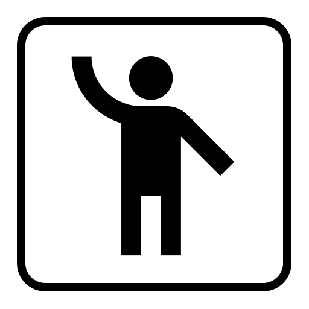

# Picto

Picto is a small web app for quickly building **visual schedules**: short, ordered sequences of pictograms that show someone what is going to happen, step by step. A typical morning routine might be *wake up → toilet → brush teeth → get dressed → breakfast → school*.

Visual schedules are widely used with children, and with adults, who benefit from visual guidance, for example people with autism, ADHD, intellectual disabilities or language difficulties. They are equally handy for any child learning a new routine.

## What it does

- **Keep several sequences.** The home screen, *My Picto collections*, lists all your sequences ("Morning", "School day", "Bedtime", ...). Each row shows a preview of the first pictograms and how many there are. Tap a sequence to open it, use the pencil to rename it, or use the bin to delete it (after a confirmation). **New sequence** creates one and opens it straight away.
- **Add pictures.** Inside a sequence, tap **+**. The dialog has three tabs:
  - **Piktogrammer** (pictograms): type a word (for example "brush teeth") and pick from the matching pictograms from [ARASAAC](https://arasaac.org), a large free library of pictograms made for augmentative and alternative communication (AAC).
  - **Fotos** (photos): freely licensed photos and drawings from [Wikimedia Commons](https://commons.wikimedia.org). Danish search words work. Each photo's author and licence are kept and listed on the About page, as some licences require. Commons has no "safe search" filter, so an adult should do the searching. Locking editing hides adding altogether.
  - **Eget billede** (own image): take a photo or pick one from the phone's library. Choose what goes on the pictogram: drag the photo to move it inside the square frame, and zoom with two fingers (pinch), the mouse wheel or the zoom slider. Or switch off "Beskær til kvadrat" (crop to a square) to keep the whole image. Then give it a label. The photo is shrunk to at most 800 px and stored **only on this device** (in the browser's IndexedDB); it is never uploaded. Add Picto to the Home Screen, especially on iPhone: Safari may otherwise delete a website's stored data after 7 days without use.

  For any other picture on the web, long-press it, choose "Save image", and add it from the photo library.
- **Build the sequence.** Each chosen pictogram is added to the bottom as a card with its image and label.
  - **Reorder** by dragging a card to its new place. With a mouse, just drag. On a phone or tablet, press and hold briefly, then drag; a quick swipe still scrolls the page.
  - **Delete** by dragging a card onto the bin that appears at the side of the screen while dragging: on the left by default, or on the right if you prefer (*Settings → Bin position*). An **Undo** button shows for a few seconds afterwards.
  - **Edit the label** by tapping it. Enter or tapping elsewhere saves, Escape cancels.
  - **With the keyboard:** Tab to a card, press Space to pick it up, use the arrow keys to move it and Space to drop it. Delete deletes the focused card. Screen readers get spoken instructions and updates in the current language.
- **Print or save as PDF.** The printer icon next to each sequence opens a print preview of an A4 page. The preview shows whole A4 sheets on screen, exactly as they will print. Choose:
  - **Stående/Liggende:** the paper is portrait or landscape.
  - **Vis titel:** show the sequence name at the top of each page.
  - **Vandret/Lodret:** the direction of the sequence. Horizontal reads left to right in rows; vertical reads top to bottom in columns, continuing in the next column to the right.
  - **−/+:** how many pictograms go in each row (or each column, when vertical). Fewer means bigger pictograms. **Auto** picks the biggest pictograms that keep the whole sequence on one page.
  - **Ombryd sekvensen** (wrap): off (the default) puts one row or column on each page, and whatever doesn't fit continues on the next page. On, rows (or columns) fill each page side by side before continuing on the next.

  Swipe left/right (or use the arrows) to see each page. Print and PDF include every page, numbered when there's more than one. These print settings are remembered on the device. **Udskriv** opens the device's print dialog. **Gem PDF** makes a PDF file in the app: on a phone it opens the share sheet (save to Files, AirDrop, Messages, print ...), and on a computer it downloads. The PDF looks the same on every device, which matters on iPhones, where the print dialog has no "Save as PDF".
- **Lock editing.** The padlock at the top right switches editing off and on. While locked, sequences can be opened and viewed, but nothing can be dragged, deleted, renamed, relabelled or added. Handy when handing the tablet to a child. The lock is remembered across reloads.
- **Danish or English.** The interface is in Danish by default; switch to English under *Settings → Sprog / Language*. ARASAAC has no Danish keywords, so in Danish mode a search tries Norwegian (Bokmål) first, which matches many Danish words ("hund", "skole", "børste"), and falls back to English. The search dialog says which language the results came from, and you can rewrite the label in Danish afterwards.
- **It's remembered.** Everything is saved in the browser on the device (sequences and settings in `localStorage`, own photos in IndexedDB), so it's all still there the next time you open Picto on the same device. There are no accounts and no server-side storage, and nothing leaves the device except search words sent to ARASAAC or Wikimedia Commons (see [Privacy](#privacy)).
- **Start over.** *Settings → Clear* deletes all sequences.
- **Storage.** *Settings → Storage* shows how much space Picto uses: sequences and settings against the browser's ~5 MB for them (a sequence of 10 pictograms takes about 1.5 kB), and own photos against the space the browser allows for them. There's no limit on sequences. If a change ever can't be saved (storage full or blocked), a red warning says so instead of the change silently disappearing on the next reload.

Picto is made for **phones first** (iPhone and Android), and works on tablets and computers too. Sequences are a single column of large cards that can be held up for a child to see, every button is at least 44 px (Apple's minimum touch target), and no screen scrolls sideways, even at 375 px. It can be added to the Home Screen and opens full screen with its own name and icon.

## Privacy

Everything you make in Picto (sequences, your own images, settings) is stored only in the browser on your device. It is never sent to a server, including the one that hosts Picto. There are no accounts, cookies, analytics or ads. When you search, only the search word goes to ARASAAC or Wikimedia Commons, and their pictures are loaded from their servers, so those services see the device's IP address, as with any website. PDFs are made on the device. The About page has the full statement in Danish and English, and `e2e/privacy.spec.js` checks it against the requests the app actually makes. The production server also sends a strict Content Security Policy (`security-headers.conf`): the browser may only run Picto's own scripts and only load pictures from ARASAAC, Wikimedia Commons and the device itself.

## Running it

All tooling runs in Docker; nothing needs to be installed on the host apart from Docker itself.

```sh
# Production build, served by nginx on http://localhost:8090
docker compose up --build app

# Development server with hot reload on http://localhost:3000
docker compose up dev
```

Set `PICTO_PORT` or `PICTO_DEV_PORT` to use different host ports, for example `PICTO_PORT=9000 docker compose up --build app`.

Other tasks run in the `dev` container:

```sh
docker compose run --rm dev npm test            # unit tests (Vitest + Testing Library)
docker compose run --rm e2e                     # browser tests: desktop Chrome, Android (Pixel 7), iPhone (WebKit)
docker compose run --rm dev npm run test:watch  # tests in watch mode
docker compose run --rm dev npm run lint        # ESLint
docker compose run --rm dev npm run build       # build to dist/
docker compose run --rm dev npm install <pkg>   # add a dependency (updates package-lock.json)
```

`node_modules` lives in a named Docker volume (`picto_node_modules`), not in the project folder.

## How it works

Picto is a fully static single-page app (React, MUI, React Router, built with Vite). It has no backend of its own:

```
Browser ──search──▶ api.arasaac.org/v1/pictograms/{nb|en}/search/{text}
        ──images──▶ static.arasaac.org/pictograms/{id}/{id}_{300|500}.png
        ──photos──▶ commons.wikimedia.org/w/api.php (search), upload.wikimedia.org (images)
        ──state───▶ localStorage["collections"], ["language"], ["editLocked"], ["preferences"]
        ──own images─▶ IndexedDB "picto" / "images"
```

The production image is just the built files served by nginx on port 80 (with a healthcheck), with a fallback to `index.html` so client-side routes such as `/about` work when loaded directly.

Putting it online is handled outside this repo: a separate, private deployment builds the Dockerfile's `prod` stage and runs it behind a reverse proxy. Keep that stage working, and keep server names, domains and logins out of this repo.

## Pictogram licence

The pictographic symbols used are the property of the Government of Aragón and have been created by Sergio Palao for [ARASAAC](https://arasaac.org), which distributes them under a [Creative Commons BY-NC-SA](https://creativecommons.org/licenses/by-nc-sa/4.0/) licence. That means attribution is required (shown on the About page), use must be **non-commercial**, and derivatives must be shared alike.

## History

- **0.1 (2020–2021):** Create React App with Material-UI v4. Icons came from the Flaticon API through a small Express server that held the API key. The Flaticon v2 API has since been replaced by the paid Freepik API.
- **1.0 (2026):** A complete overhaul.
  - **Stack:** rebuilt on Vite, React 19, MUI 9 and React Router 8. Pictograms come from ARASAAC (no key, so no server); the app is static, served by nginx with compression.
  - **Features:** multiple sequences, a Danish/English interface, drag-and-drop editing with a bin and undo, an edit lock, printing and PDF (orientation, direction, wrapping, pages), photos from Wikimedia Commons, and own photos with crop and zoom.
  - **Phone-first,** and tested on desktop, Android and iPhone. Schedules saved by 0.1 still load.
